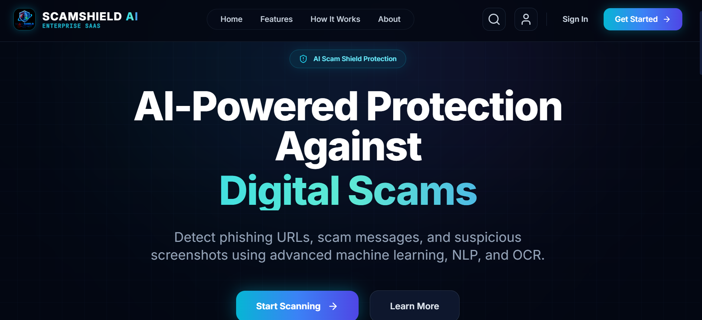
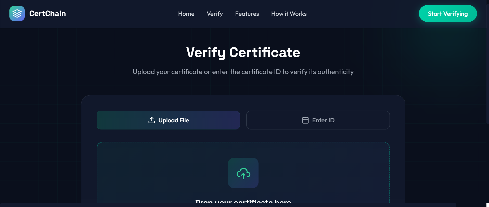
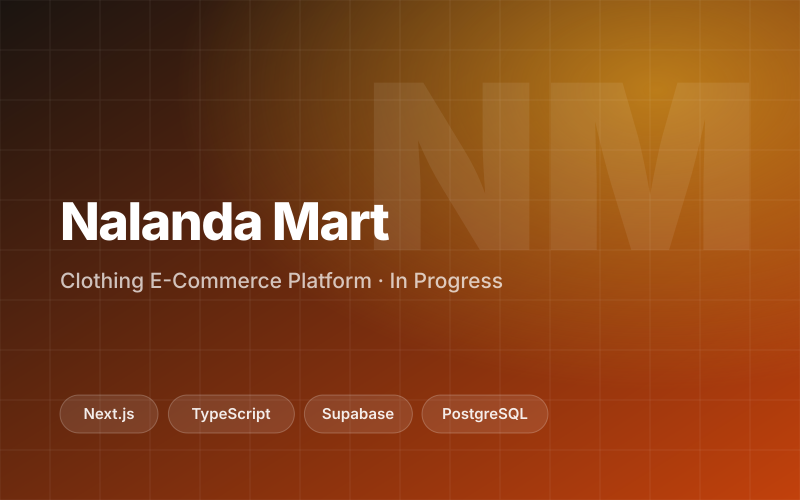

<div align="center">

# ⚡ MD Roqias Iqbal
### **AI & Machine Learning Engineer | Full-Stack Developer**

<p align="center">
  <a href="https://linkedin.com/in/roqais-iqbal-86bab1326/">
    
  </a>
  <a href="https://github.com/Roquaish1015">
    
  </a>
  <a href="mailto:mdroquaish1015@gmail.com">
    
  </a>
  <a href="https://scamshield-ai-2-71tq.onrender.com">
    
  </a>
</p>

<p align="center">
  <strong>Specializing in building and deploying production-ready ML systems end-to-end — from deep learning models and NLP pipelines to robust FastAPI backends and responsive Next.js interfaces.</strong>
</p>

---

<p align="center">
  
  
  
  
  
</p>

</div>

---

## 📌 Table of Contents

- [About Me](#-about-me)
- [Featured Projects](#-featured-projects)
  - [1. Scam Shield AI](#1-scam-shield-ai)
  - [2. Blockchain Certificate Verification](#2-blockchain-based-certificate-verification)
  - [3. Nalanda Mart](#3-nalanda-mart)
- [Technical Arsenal](#-technical-arsenal)
- [Work Experience](#-work-experience)
- [Education & Certifications](#-education--certifications)
- [Project Architecture & Structure](#-project-architecture--structure)
- [Local Development & Setup](#-local-development--setup)
- [Connect With Me](#-connect-with-me)

---

## 👨‍💻 About Me

Final-year **Computer Science Engineering student** specializing in **Artificial Intelligence & Machine Learning** at IILM University.

- 🧠 **Primary Focus:** Deep learning, Natural Language Processing (NLP) classification pipelines, PyTorch/Hugging Face models, LLM-based reasoning, and scalable AI-powered REST APIs.
- 🌐 **Secondary Strength:** Full-stack development with Next.js, React, FastAPI, Supabase, and PostgreSQL.
- 🤖 **Next-Gen Tooling:** Experienced with Agentic AI workflows, Claude Code, Model Context Protocol (MCP), and custom Agent Skills.
- 🎯 **Engineering Philosophy:** Building models is only half the battle; real value comes from packaging them into reliable, well-tested, deployed systems that solve real human problems.

---

## 🚀 Featured Projects

### 1. Scam Shield AI
> **Intelligent Multi-Modal Scam Detection & Threat Intelligence Platform**  
> 🔗 **Live URL:** [scamshield-ai-2-71tq.onrender.com](https://scamshield-ai-2-71tq.onrender.com)  
> 🛠️ **Stack:** `Python` • `PyTorch` • `Hugging Face Transformers` • `FastAPI` • `PostgreSQL` • `OCR` • `Next.js`

<div align="center">
  
</div>

<br/>

- **Multi-Stage Detection Pipeline:** Engineered a hybrid detection architecture combining a fine-tuned NLP classification model, rule-based heuristic signal detection, and LLM-driven contextual reasoning.
- **Multi-Input Analysis:** Analyzes raw text, suspicious emails, malicious URLs, QR codes, and screenshot images (via OCR) to compute an explainable risk score (0–100).
- **Threat Vector Coverage:** Classifies phishing, payment fraud, fake job postings, and investment scams with granular risk-factor breakdowns.
- **Production Backend & Security:** High-throughput FastAPI REST API backed by relational PostgreSQL schemas for scan history, JWT-authenticated user sessions, and input sanitization to prevent prompt-injection attacks.

---

### 2. Blockchain-Based Certificate Verification
> **Tamper-Proof Academic & Professional Credential Verification System**  
> 🔗 **Live URL:** [cozy-sherbet-5c47d1.netlify.app](https://cozy-sherbet-5c47d1.netlify.app)  
> 🛠️ **Stack:** `JavaScript` • `Blockchain Architecture` • `SHA Cryptographic Hashing` • `Web3 Concepts`

<div align="center">
  
</div>

<br/>

- **Immutable Proof:** Implemented cryptographic hashing (SHA) to generate unique fingerprint hashes for credentials, preventing credential forgery.
- **Zero-Trust Verification:** Enables employers and third parties to instantly verify authenticity without relying on centralized single-point-of-failure databases.
- **End-to-End Lifecycle:** Complete issuance, digital signing, registry recording, and public verification workflow.

---

### 3. Nalanda Mart
> **Modern Variant-Driven E-Commerce Experience** *(In Active Development)*  
> 🛠️ **Stack:** `Next.js (App Router)` • `TypeScript` • `PostgreSQL` • `Supabase` • `Tailwind CSS`

<div align="center">
  
</div>

<br/>

- **Variant-Based Product Engine:** Dynamic SKU and inventory handling across sizes, colors, and stock levels.
- **Role-Based Admin Portal:** Secure administrative CRUD operations for catalog management, sales tracking, and media uploads.
- **Performant Architecture:** Built using Next.js Server Components and Supabase relational PostgreSQL with Row Level Security (RLS).

---

## 🛠️ Technical Arsenal

<table align="center" width="100%">
  <thead>
    <tr>
      <th width="28%">Domain</th>
      <th width="72%">Technologies & Frameworks</th>
    </tr>
  </thead>
  <tbody>
    <tr>
      <td><strong>🤖 AI & Machine Learning</strong></td>
      <td>
        
        
        
        
        
        
        
        <br/>
        <em>NLP Pipelines • Text Classification • LLM Reasoning • OCR • Model Evaluation</em>
      </td>
    </tr>
    <tr>
      <td><strong>🧠 Agentic AI & Tooling</strong></td>
      <td>
        
        
        
        
      </td>
    </tr>
    <tr>
      <td><strong>⚙️ Backend & Data</strong></td>
      <td>
        
        
        
        
        
        
      </td>
    </tr>
    <tr>
      <td><strong>🎨 Frontend Development</strong></td>
      <td>
        
        
        
        
        
        
        
      </td>
    </tr>
    <tr>
      <td><strong>🚀 DevOps & Systems</strong></td>
      <td>
        
        
        
        
        
        
        
      </td>
    </tr>
  </tbody>
</table>

---

## 💼 Work Experience

#### **Software Development Intern** | Code Alpha Ltd.
*📅 Jun 2025 – Jul 2025 • Remote*
- Developed and maintained responsive, cross-browser web interfaces adhering to modern UI/UX principles.
- Conducted root-cause debugging on production issues, improving overall page load times and UX stability.
- Collaborated in a fast-paced Agile team through peer code reviews, continuous iteration, and strict Git/GitHub branching strategies.
- Gained comprehensive hands-on exposure to full-cycle SDLC from feature specifications to automated staging deployment.

---

## 🎓 Education & Certifications

### Education
- **B.Tech in Computer Science Engineering (AI & ML)**  
  *IILM University* | `2023 – 2027`
- **Diploma in Computer Science Engineering**  
  *Mansarovar Global University* | `2021 – 2023`

### Certifications
- 🏆 **AWS Academy Machine Learning** — *Amazon Web Services (AWS Training)* • Oct 2025
- 🏆 **Generative AI** — *Great Learning* • Apr 2024
- 🏆 **Internet of Things 201** — *Infosys Springboard* • Nov 2024

---

## 📂 Project Architecture & Structure

```bash
portfolio-site/
├── assets/
│   ├── css/                # Compiled styles and vendor libraries
│   ├── images/
│   │   ├── avatar/         # Profile and avatar visuals
│   │   ├── icons/          # Tech stack brand & UI vector assets
│   │   ├── item/           # Background graphics and design vectors
│   │   ├── logo/           # Branding marks & SVGs
│   │   └── projects/       # High-res project mockups & banners
│   └── scss/               # Modular Sass architectures (core, component, abstracts)
├── _next/                  # Static production build assets & chunks
├── index.html              # Main interactive single-page portfolio
├── 404.html                # Custom animated 404 page
├── favicon.ico             # Portfolio favicon
└── README.md               # Repository documentation & portfolio showcase
```

---

## 💻 Local Development & Setup

You can run this portfolio locally with any local static web server:

### Option 1: Python HTTP Server (Zero Dependencies)
```bash
# Navigate to the repository root
cd portfolio-site

# Start a local HTTP server
python -m http.server 3000
```
Open your browser at `http://localhost:3000`.

### Option 2: Node.js `serve` / `npx`
```bash
# Run with npx serve
npx serve . -p 3000
```

### Option 3: VS Code Live Server
Simply install the **Live Server** extension in VS Code, right-click `index.html`, and select **"Open with Live Server"**.

---

## 📬 Connect With Me

Let's discuss AI/ML collaborations, engineering roles, or innovative product builds!

<p align="left">
  <a href="https://linkedin.com/in/roqais-iqbal-86bab1326/">
    
  </a>
  <a href="mailto:mdroquaish1015@gmail.com">
    
  </a>
  <a href="https://github.com/Roquaish1015">
    
  </a>
</p>

---

<div align="center">
  <sub>Crafted with passion, precision, and state-of-the-art engineering by <strong>MD Roqias Iqbal</strong>. ⭐ Star this repo if you find it inspiring!</sub>
</div>
